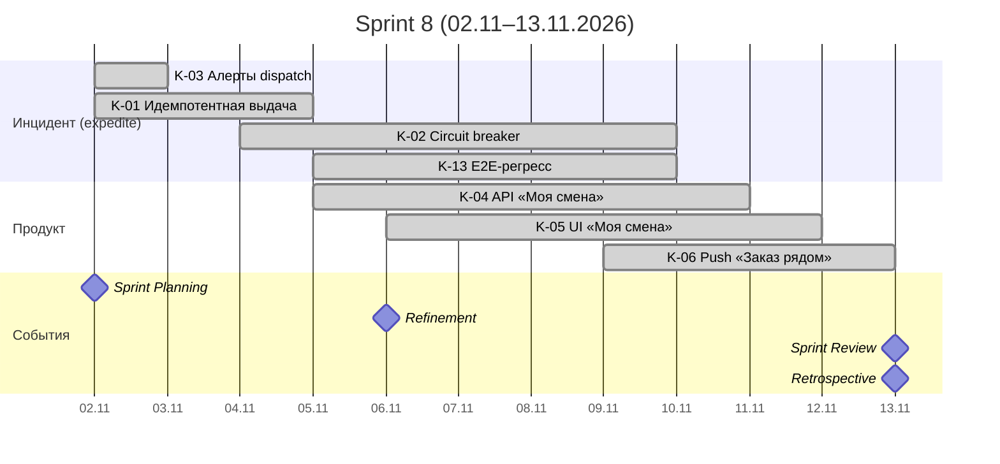

# Задача 14. Сервис доставки еды (курьерское приложение)

**Студент:** Кислая Д.А.

## Постановка задачи

> **14. Сервис доставки еды (курьерское приложение)**
>
> Операционный инцидент: падает назначение заказов. Опишите, как команда совмещает Scrum-спринт с Kanban-потоком hotfix (expedite lane). XP: Continuous Integration, Pair Programming на инциденте, Sustainable Pace после пожара.

**Допущения, на которых построено решение.** Продукт — курьерское приложение «Курьер+» сервиса «ЕдаРядом»: 4 200 курьеров в 11 городах, ~38 000 заказов в сутки. Ядро — сервис `dispatch`: он выбирает курьера под заказ (расстояние ≤ 2 км, рейтинг ≥ 4,6, свободная смена) и присылает пуш. 30.10.2026 в 22:40 доля ошибок `dispatch` выросла до 18 %, автоназначение остановилось, заказы ушли в ручной диспетчер (12 операторов). Инцидент получил номер **INC-1420**, причина — гонка двух воркеров `dispatch` при ретрае по таймауту: повторное назначение писало в ту же строку заказа и роняло обработчик. Разбор и «пожар» заняли субботу 31.10 (11 часов), в воскресенье команда не работала. С понедельника 02.11 стартует **Sprint 8**.

## Общие правила (из методички, сжато)

- Сдача — текст + схемы в Markdown-репозитории: допустимы mermaid, ASCII, таблицы, скриншоты досок.
- Язык — русский; термины Scrum/Kanban/XP можно оставлять на английском с пояснением при первом упоминании.
- Объём README — 3–6 экранов; без общих определений и «воды», всё привязано к своей постановке.
- Продакшен-код продукта не требуется: достаточно текстовой/табличной модели доски и бэклога.
- Все роли, задачи, оценки и метрики — конкретные; ФИО студента и постановка — в README.
- Репозиторий публичный, артефакты: `README.md` (отчёт по Scrum/Kanban/XP) и `board.md` (доска).

---

## 1. Scrum

### 1.1 Команда и продукт

| Участник | Роль | Зона ответственности в «Курьер+» |
|---|---|---|
| Марина Соколова | Product Owner (PO) | Приоритеты бэклога, SLA назначения, приёмка спринта |
| Илья Ветров | Scrum Master (SM) | Фасилитация событий, снятие блокеров, защита команды от «срочностей» |
| Артём Ковалёв | Разработчик, tech lead backend | `dispatch`, идемпотентность, circuit breaker, мониторинг |
| Дарья Лебедева | Разработчик backend | `dispatch`, ручной диспетчер, ретраи, индексы БД |
| Никита Орлов | Разработчик iOS | Экран «Моя смена», push, клиентский ретрай |
| Полина Захарова | Разработчик Android | Экран «Моя смена», push, владелец Kanban-доски |
| Сергей Морозов | QA automation | E2E-тесты назначения, регресс, приёмка hotfix |

Ёмкость спринта — **33 story points (SP)**: 7 человек × 10 рабочих дней с учётом 20 % резерва на инцидент. Средняя скорость последних трёх спринтов — 31,3 SP (31 / 34 / 29). В Sprint 8 взято **29 SP**: 16 SP на инцидент и 13 SP на продуктовые фичи, плюс 4 SP незапланированного резерва.

### 1.2 Product Backlog

| ID | Элемент | Тип | SP | Приоритет | Статус |
|---|---|---|---:|---|---|
| PB-01 | Стабилизация автоназначения: идемпотентная выдача заказа курьеру (INC-1420) | Bug/Incident | 8 | P0 | Done |
| PB-02 | Circuit breaker и ручной диспетчер при отказе автоназначения | Техдолг | 5 | P0 | Done |
| PB-03 | Мониторинг `dispatch`: p99 назначения, 5xx, очередь неназначенных | Техдолг | 3 | P0 | Done |
| PB-04 | Экран «Моя смена»: заказы и заработок за день | Feature | 8 | P1 | Done |
| PB-05 | Push «Новый заказ рядом» с принятием в 1 тап | Feature | 5 | P1 | Done |
| PB-06 | Офлайн-режим: кэш адресов и статусов доставки | Feature | 8 | P1 | Ready |
| PB-07 | Маршрут до клиента на карте с ETA | Feature | 5 | P2 | Ready |
| PB-08 | Подтверждение доставки фото пакета у двери | Feature | 3 | P2 | Backlog |
| PB-09 | Чат курьера с поддержкой по заказу | Feature | 5 | P2 | Backlog |
| PB-10 | Реферальная программа для курьеров | Feature | 5 | P3 | Backlog |
| PB-11 | Энергосбережение: геотрекинг раз в 30 с вместо 5 с | Техдолг | 3 | P2 | Ready |
| PB-12 | A/B-тест порога автоназначения 2 км / 3 км | Experiment | 3 | P3 | Backlog |

Правило приоритизации: P0 — «курьер не получает заказ» (деньги и SLA), P1 — «курьер теряет время в смене», P2 — качество смены, P3 — рост. Инцидент INC-1420 поднял PB-01…PB-03 в P0 и вытеснил из спринта PB-06 (офлайн-режим, 8 SP) — она осталась Ready и ушла в Sprint 9.

### 1.3 Sprint Goal

> **«Вернуть курьеру предсказуемую смену: автоназначение работает в 99,5 % случаев, курьер видит назначенный заказ не дольше 5 секунд, а экран „Моя смена“ показывает заработок за день без звонка в поддержку».**

Метрики успеха: доля успешных автоназначений ≥ 99,5 %; p99 ответа `dispatch` ≤ 2 с; 5xx ≤ 0,2 %; «Моя смена» доступна 100 % курьеров Android/iOS; 0 повторных P0 за 5 рабочих дней после релиза фикса.

### 1.4 Sprint Backlog (Sprint 8, 02.11–13.11.2026, 29 SP)

| ID | Карточка | Задача | SP | Исполнитель | Статус |
|---|---|---|---:|---|---|
| SB-1.1 | K-01 | Идемпотентная выдача: ключ `order_id+courier_id`, unique-индекс, retry-safe consumer в `dispatch` | 6 | Артём + Дарья (pair) | Done 05.11 |
| SB-1.2 | K-13 | E2E-регресс «двойное назначение»: таймаут, повтор, два воркера | 2 | Сергей | Done 10.11 |
| SB-2 | K-02 | Circuit breaker: при 5xx > 5 % автоназначение выключается, заказ уходит в ручной диспетчер | 5 | Дарья | Done 10.11 |
| SB-3 | K-03 | Алерты Grafana: p99 назначения > 2 с, 5xx > 2 %, очередь неназначенных > 20 | 3 | Артём | Done 03.11 |
| SB-4.1 | K-04 | API смены: список заказов, сумма заработка, кэш на 5 мин | 5 | Артём | Done 11.11 |
| SB-4.2 | K-05 | UI «Моя смена» (Android + iOS): список, итог дня, состояния загрузки/ошибки | 3 | Полина + Никита | Done 12.11 |
| SB-5 | K-06 | Push «Новый заказ рядом»: приоритетный канал, принятие в 1 тап, отказ с причиной | 5 | Полина + Никита | Done 13.11 |

Сумма: 6 + 2 + 5 + 3 + 5 + 3 + 5 = **29 SP**. Инцидент — 16 SP (55 %), продукты — 13 SP (45 %). Важно: PB-01 закрывается только после K-13, поэтому релиз фикса — 05.11, а элемент бэклога в Done — 10.11. Декомпозиция по дням:

### 1.5 События спринта

| Событие | Когда / длительность | Повестка | Результат |
|---|---|---|---|
| Sprint Planning | 02.11, 10:00–12:00, 2 ч | Итоги INC-1420; Sprint Goal; разбор PB-01…PB-05; декомпозиция до карточек ≤ 8 SP | Взято 29 SP, 7 карточек; PB-06 снята в пользу инцидента; зафиксирован WIP=1 для expedite |
| Daily Scrum | ежедневно 10:00, 15 мин | Что сделал для Sprint Goal; что сделаю; блокеры; отдельно — статус INC-1420 | 04.11: K-02 заблокирована (нет доступа к прод-конфигу) — SM поднял вопрос в тот же день, доступ выдан 05.11 11:00, блокер стоил 1 день |
| Backlog Refinement | 06.11, 14:00–14:45 | PB-06…PB-12: критерии приёмки, оценки, зависимости | PB-06/PB-07/PB-11 получили DoR и ушли в Ready; PB-09 разбита на «чат» и «вложения» |
| Sprint Review | 13.11, 16:00–17:30 | Демо курьеру-«другу команды» и старшему диспетчеру: фикс, «Моя смена», push; метрики недели | PO принял 5 элементов; 2 замечания: порог 2 км даёт ложные пуши (→ PB-12) и нужен звук push (→ PB-05, follow-up) |
| Retrospective | 13.11, 17:30–18:30 | Start/Stop/Continue, таймлайн инцидента, 5 улучшений с владельцами | 5 действий (см. 1.10); контроль — на Daily по пятницам |

### 1.6 Definition of Ready и Definition of Done

**DoR (карточка входит в спринт, только если):**
1. Есть user story и 2–4 критерия приёмки на языке курьера («вижу заказ за ≤ 5 с», «заработок совпадает с выплатой»).
2. Описан контракт API или макет экрана; для `dispatch` — схема данных заказа и курьера.
3. Понятна метрика успеха (p99, доля успешных назначений, время до принятия).
4. Есть тестовые данные: 3 тестовых курьера, 10 заказов, песочница `dispatch`.
5. Оценка ≤ 8 SP и задача не зависит от незавершённого элемента.
6. Для инцидента — воспроизведение в песочнице или логах и владелец из on-call.

**DoD (карточка попадает в Done, только если):**
1. Код в `main`, PR ≤ 400 строк, ревью двух разработчиков.
2. Зелёный CI: unit + 3 E2E-сценария назначения, сборка ≤ 12 мин.
3. Фича за feature flag, выкат через canary 10 % на 30 мин.
4. Проверено на живом устройстве: Android 10+, iPhone 12, сеть 3G.
5. Есть метрика/алерт в Grafana и запись в runbook.
6. Обновлён CHANGELOG, демо показано PO, критерии приёмки отмечены.
7. Для hotfix — постмортем INC-1420 дополнен и разобран с дежурными.

### 1.7 Как инцидент встроен в спринт

- **До спринта.** 30.10 22:40 — алерт, 23:10 — откат `dispatch` v2.14.0 → v2.13.3 и перевод города на ручной диспетчер; 31.10 — разбор (11 часов, суббота). Sprint 8 спланирован уже с инцидентом: PB-01…PB-03 стоят первыми, PB-06 вытеснена.
- **Внутри спринта.** Инцидент живёт в Kanban-потоке на полосе **expedite lane** (полоса ускоренных задач) с WIP = 1: в работе одновременно не больше одной hotfix-карточки. Карточки K-01, K-02, K-03, K-13 идут вне очереди Ready, но **не отменяют DoD**: ревью, CI, canary и проверка на устройстве обязательны.
- **Правила expedite.** Заводит только PO или дежурный при P0 (курьер не получает заказы); приоритет выше любой фичи; диагностика ≤ 4 ч, проверка ≤ 1 рабочего дня; каждый день в 10:15 — отдельная 10-минутная синхронизация по инциденту; после закрытия — постмортем в течение 2 рабочих дней.
- **Баланс.** 16 из 29 SP — инцидент. Фичи K-04…K-06 не бросались, а шли вторым потоком: пара mobile-разработчиков начала UI 06.11, сразу после мержа контракта API (сама K-04 закрылась 11.11 — ждали тесты). Резерв 4 SP остался нетронутым — его не хватило бы на второй P0, поэтому PB-06 и не брали.

### 1.8 Итог спринта

29 из 29 SP, 7 из 7 карточек в Done, Sprint Goal достигнут: автоназначение 99,7 %, p99 ответа 1,8 с, 5xx 0,12 %, курьер видит заказ через 3,2 с, «Моя смена» раскатана на 100 % в пятницу 13.11. Повторных P0 после 05.11 не было. Остаток по дням — в таблице 1.9; спринт просел на отрезке 05–09.11 (плато 20 SP), когда команда ждала тестовый контур и разбиралась с блокером K-02.

### 1.9 Burndown спринта

| День | Дата | Идеал, SP | Факт, SP | За день, SP | Комментарий |
|---:|---|---:|---:|---:|---|
| 0 | 02.11 | 29,0 | 29,0 | 0 | Sprint Planning |
| 1 | 02.11 | 26,1 | 29,0 | 0 | восстановление после аврала 31.10 |
| 2 | 03.11 | 23,2 | 26,0 | 3 | K-03 алерты в Done |
| 3 | 04.11 | 20,3 | 26,0 | 0 | пара на K-01; K-02 заблокирована доступом |
| 4 | 05.11 | 17,4 | 20,0 | 6 | K-01 в Done, canary 10 % → 100 % |
| 5 | 06.11 | 14,5 | 20,0 | 0 | разбор регресса на canary, refinement |
| 6 | 09.11 | 11,6 | 20,0 | 0 | K-02 и K-13 в работе, Review/Test на лимите |
| 7 | 10.11 | 8,7 | 13,0 | 7 | K-13 + K-02 в Done |
| 8 | 11.11 | 5,8 | 8,0 | 5 | K-04 API смены в Done |
| 9 | 12.11 | 2,9 | 5,0 | 3 | K-05 UI смены в Done |
| 10 | 13.11 | 0,0 | 0,0 | 5 | K-06 push в Done; Review и Retro |

Плато 05–09.11 — не простой, а ожидание тестового контура: карточки были в работе, но не проходили DoD. К 13.11 остаток закрыт полностью.

### 1.10 Ретроспектива

**13.11.2026, 17:30–18:30, фасилитатор Илья Ветров (SM).** Start/Stop/Continue + таймлайн INC-1420, правило «без обвинений».

| № | Улучшение | Что делаем | Владелец | Срок |
|---:|---|---|---|---|
| 1 | Авто-откат canary для `dispatch` | откат при 5xx > 1 % за 30 мин, шаг входит в DoD | Артём Ковалёв | 20.11.2026 |
| 2 | Пара на каждом P0 | два исполнителя в карточке, ротация driver/navigator каждые 2 ч | Илья Ветров | 16.11.2026 |
| 3 | Runbook INC-1420 + учения | пошаговое восстановление и учебная тревога с дежурным | Дарья Лебедева | 25.11.2026 |
| 4 | E2E-тесты назначения в CI | 3 сценария (двойное назначение, таймаут, повтор) в блокирующем гейте | Сергей Морозов | 27.11.2026 |
| 5 | Границы смены после «пожара» | деплой до 18:00, on-call до 20:00, recovery-день после P0-аврала | Марина Соколова | 16.11.2026 |

Пункты 1, 2, 5 проверяются на Daily по пятницам; 3 и 4 — на Review Sprint 9; итог — на ретро 27.11.2026.

---

## 2. Kanban

### 2.1 Доска, колонки и WIP-лимиты

Доска Sprint 8 — в `board.md` (mermaid + ASCII-снимок + карточки). Колонки: **Backlog → Ready → In Progress → Review/Test → Done** и отдельная полоса **Expedite lane** для INC-1420.

| Колонка | WIP | Обоснование |
|---|---:|---|
| Backlog | ∞ | Место хранения; вход только через refinement |
| Ready | 5 | Больше 5 карточек = очередь, которую команда не успеет начать за спринт; 5 покрывает 3–4 дня потока |
| In Progress | 3 | 5 разработчиков, но парная работа и дежурство: 3 параллельные задачи — предел без переключений |
| Review/Test | 2 | Один QA + ревью; больше 2 карточек создают очередь на тестирование (подтверждено снимком 09.11) |
| Done | ∞ | Архив спринта |
| Expedite lane | 1 | Одна P0-карточка за раз; вторая означала бы, что команда тушит два пожара и фичи встали полностью |

### 2.2 Правила перехода

| Переход | Условие входа | Кто подтверждает |
|---|---|---|
| Backlog → Ready | Выполнен DoR: story + критерии, макет/контракт, тестовые данные, оценка ≤ 8 SP | PO + SM на refinement |
| Ready → In Progress | Есть свободный слот WIP, назначен исполнитель (для P0 — пара), ветка создана | Разработчик, SM следит за лимитом |
| In Progress → Review/Test | Код в PR, CI зелёный, есть описание проверки и тестовые данные | Автор + ревьюер |
| Review/Test → Done | Выполнен DoD: 2 ревью, E2E, canary 10 %, проверка на устройстве, алерт, демо PO | QA + PO |
| Expedite → Done | То же + постмортем и запись в runbook | PO + дежурный |
| Любая → Blocked | Блокер зафиксирован в карточке, владелец и срок снятия назначены | SM |

### 2.3 Снимок доски на 09.11.2026, 18:00 (день 6 из 10)

В работе 3 карточки (лимит 3), в Review/Test 2 (лимит 2), в Ready 3 из 5. Сделано 9 SP из 29, остаток 20 SP — совпадает с `burndown.csv` за день 6.

```mermaid
flowchart LR
    subgraph BL["Backlog (∞)"]
        direction TB
        K09["K-09 Фото 3 SP"]
        K10["K-10 Чат 5 SP"]
        K12["K-12 Runbook 2 SP"]
        K14["K-14 A/B 3 SP"]
        K15["K-15 Реферал 5 SP"]
    end
    subgraph RD["Ready (5)"]
        direction TB
        K07["K-07 Офлайн 8 SP"]
        K08["K-08 Маршрут 5 SP"]
        K11["K-11 Батарея 3 SP"]
    end
    subgraph IP["In Progress (3)"]
        direction TB
        K02["K-02 Circuit breaker 5 SP ⚡"]
        K04["K-04 API смены 5 SP"]
        K06["K-06 Push 5 SP"]
    end
    subgraph RT["Review/Test (2)"]
        direction TB
        K05["K-05 UI смены 3 SP"]
        K13["K-13 E2E 2 SP ⚡"]
    end
    subgraph DN["Done (∞)"]
        direction TB
        K01["K-01 Идемпотентность 6 SP ⚡"]
        K03["K-03 Алерты 3 SP ⚡"]
    end
    BL --> RD --> IP --> RT --> DN
    classDef hot fill:#ffe3e3,stroke:#c0392b,color:#7b1c1c
    class K01,K02,K03,K13 hot
```

ASCII-версия с полосами (swimlanes) — в `board.md`, раздел «Снимок».

### 2.4 Метрики потока

| Карточка | SP | В Ready | Старт | Done | Lead time, раб. дн. | Cycle time, раб. дн. | Полоса |
|---|---:|---|---|---|---:|---:|---|
| K-03 Алерты dispatch | 3 | 02.11 | 02.11 | 03.11 | 1 | 1 | Expedite |
| K-01 Идемпотентность | 6 | 30.10 | 02.11 | 05.11 | 4 | 3 | Expedite |
| K-02 Circuit breaker | 5 | 30.10 | 04.11 | 10.11 | 7 | 4 | Expedite |
| K-13 E2E-регресс | 2 | 04.11 | 05.11 | 10.11 | 4 | 3 | Expedite |
| K-04 API смены | 5 | 30.10 | 05.11 | 11.11 | 8 | 4 | Продукт |
| K-05 UI «Моя смена» | 3 | 02.11 | 06.11 | 12.11 | 8 | 4 | Продукт |
| K-06 Push «Заказ рядом» | 5 | 03.11 | 09.11 | 13.11 | 8 | 4 | Продукт |

Средний lead time — **5,7 рабочих дня**, средний cycle time — **3,3**. Throughput — 0,7 карточки в день; средний WIP ≈ 4,3 карточки. Проверка по закону Литтла: 4,3 / 0,7 ≈ 6,1 дня — сходится с фактическим lead time. Разница lead и cycle (2,4 дня) — это ожидание в Ready: карточка готова, но слот занят.

### 2.5 Узкое место и что с ним делать

**Узкое место — Review/Test.** На 09.11 колонка заполнена до лимита (K-05 и K-13), а K-02 освободится только 10.11: QA Сергей тестирует в одиночку на двух платформах, сборка Android идёт 25 минут, ручной сценарий «таймаут → повтор → отказ» занимает 40 минут. Expedite-карточки при этом проходят вне очереди и дополнительно отнимают время у QA.

Действия (владельцы и сроки — в `board.md`): парное тестирование «разработчик + QA» на K-02 и K-13; перенос трёх E2E-сценариев в CI, чтобы регресс шёл автоматически; снижение Ready с 5 до 3, чтобы не копить очередь; правило «новая карточка не берётся, пока Review/Test не освободится». Ожидаемый эффект — cycle time 3,3 → 2,5 дня, lead time 5,7 → 4,5 дня.

---

## 3. XP

### 3.1 Continuous Integration (непрерывная интеграция)

**Что делаем.** Работаем в `main` через короткоживущие ветки (≤ 1 дня), PR ≤ 400 строк, два ревьюера. Пайплайн на каждый PR — 12 минут: unit-тесты `dispatch` (6 мин), 3 E2E-сценария назначения (4 мин), сборка Android/iOS (2 мин). Мерж только при зелёном CI. Релиз — canary 10 % на 30 минут; откат пока ручной, по метрикам 5xx и латентности дежурного (авто-откат — улучшение ретро № 1).

**К каким задачам привязано.** K-01 (идемпотентность), K-02 (circuit breaker), K-13 (E2E «двойное назначение»). Именно K-13 стала блокирующим тестом пайплайна: без неё фикс K-01 мог вернуться при следующем релизе.

**Зачем и эффект.** Инцидент 30.10 случился в пятницу вечером и стоил 11 часов в субботу. В спринте 41 PR ушёл в `main` без «интеграционного дня», K-01 выкатили 05.11 в 14:20, canary поймал 2 проблемы до полного раската, полный релиз — в 16:00. Повторных P0 за 8 дней нет.

**Без практики.** Ветки живут неделями, `dispatch` и мобильный клиент интегрируются в конце спринта, регресс ловится на проде — это ровно сценарий INC-1420, где рассинхрон бэкенда и клиентских ретраев дал двойное назначение.

### 3.2 Pair Programming на инциденте (парное программирование)

**Что делаем.** На K-01 три дня (02–04.11) работала пара Артём Ковалёв (driver/navigator) + Дарья Лебедева, ротация ролей каждые 2 часа; на K-02 пара Дарья + Сергей писала тест на отключение автоназначения до кода фикса. Правило: любая P0-карточка на expedite-полосе выполняется парой, в карточке указываются оба исполнителя.

**Зачем и эффект.** Пара нашла вторую половину причины: мобильный клиент повторял `POST /assign` после таймаута, поэтому фикс только на бэкенде не закрывал инцидент. В итоге в K-01 появился ключ идемпотентности на клиенте (Никита), а в K-02 — предохранитель на 5 % ошибок. Ревью «в голове» во время пары дало 0 возвратов K-01 из Review/Test по логике.

**Без практики.** Каждый чинит свой сервис в одиночку, причина остаётся в клиенте, инцидент возвращается через неделю — при P0 цена ошибки измеряется тысячами заказов и ручным диспетчером.

### 3.3 Sustainable Pace после «пожара» (устойчивый темп)

**Что делаем.** После 11-часовой субботы 31.10: воскресенье 01.11 — выходной; 02.11 Sprint Planning начался не с оценок, а с 30-минутного разбора инцидента и только потом перешёл к планированию. В спринте: не более 8 часов в день, деплой только до 18:00, on-call до 20:00 (не круглосуточно), «тихий час» 12:00–14:00 без встреч, резерв 4 SP (12 % ёмкости) не занимается фичами, expedite не превышает WIP = 1.

**К каким задачам привязано.** K-02 и K-13 (самые рискованные) шли без ночных релизов; K-05/K-06 не ставились в план на 13.11 вечером — релиз push сделали в 15:00, демо оставили на Review.

**Зачем и эффект.** Команда закончила спринт без переработок (кроме аварийной субботы до старта), 29 SP, 0 больничных, 0 откатов canary после 05.11. Скорость не просела: 29 SP против средней 31,3 — цена устранения инцидента, а не выгорания.

**Без практики.** «Героический» режим: ночные фиксы, ошибки в спешке, второй инцидент на уставшей команде. В октябре два разработчика уже брали отгулы после авралов — это прямой путь к текучке и повторным P0.

---

## 4. Согласованность артефактов

| Артефакт | Что внутри | Связь с README |
|---|---|---|
| `board.md` | Колонки, WIP, expedite lane, 15 карточек, снимок 09.11, метрики, узкое место | 7 карточек спринта = SB-1.1…SB-5, остальные — очередь Ready/Backlog |
| `README.md` | Постановка, Scrum (бэклог, события, DoR/DoD), burndown, ретро, Kanban и XP | Единый документ по трём блокам задачи |

**Итог.** Спринт закрыл операционный инцидент без остановки продукта: hotfix шёл по expedite-полосе с WIP = 1, фичи — по обычному потоку с WIP = 3/2, а XP-практики (CI, пара на P0, устойчивый темп) не дали «пожару» превратиться в норму.
