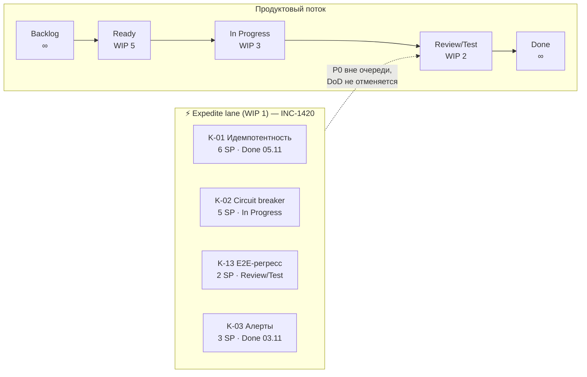

# Kanban-доска Sprint 8 — «Курьер+» (задача 14)

Доска ведётся в Jira (проект `COURIER`, board «Sprint 8 / Dispatch & Shift»). Ниже — текстовая модель: колонки, WIP-лимиты, expedite lane для INC-1420, карточки и снимок на **09.11.2026, 18:00** (день 6 из 10).

## 1. Схема потока



Правило потока: карточки двигаются только вправо и только «pull»-ом — следующий этап сам забирает карточку, когда освободился слот. Вернуть карточку назад можно лишь при провале ревью/теста с комментарием в карточке.

## 2. Колонки, WIP-лимиты и обоснование

| Колонка | WIP | Что означает | Почему такой лимит |
|---|---:|---|---|
| Backlog | ∞ | Идеи и элементы PB, ещё не готовые к спринту | Хранилище, ограничивать нечего; вход в Ready — только через refinement |
| Ready | 5 | Карточки с выполненным DoR, готовы к старту | 5 карточек ≈ 3–4 дня потока при throughput 0,7/день; больше — очередь «на полке» |
| In Progress | 3 | В работе у разработчиков | 5 разработчиков, но пары и дежурство: 3 задачи — предел без переключения контекста |
| Review/Test | 2 | Ревью кода + проверка QA | Один QA и два ревьюера; при 3 карточках образуется очередь (снимок 09.11 это подтвердил) |
| Done | ∞ | Принято PO, выполнены DoD | Архив, лимит не нужен |
| Expedite lane | 1 | Полоса P0-инцидента INC-1420 поверх колонок | Второй параллельный пожар останавливает продуктовый поток; 1 hotfix = максимум |

Текущая загрузка на снимке: **Backlog 5, Ready 3/5, In Progress 3/3, Review/Test 2/2, Done 2**.

## 3. Правила перехода

| Переход | DoR/DoD-условие | Кто проверяет | Как фиксируется |
|---|---|---|---|
| Backlog → Ready | DoR: story + критерии приёмки, макет или контракт API, тестовые данные (3 курьера, 10 заказов), оценка ≤ 8 SP, нет блокирующих зависимостей | PO + SM на refinement (06.11) | Чек-лист DoR в карточке, статус Ready |
| Ready → In Progress | Есть свободный слот WIP, назначен исполнитель, для P0 — пара, создана ветка | Разработчик; SM следит за лимитом | Карточка переведена, в поле «Пара» два имени |
| In Progress → Review/Test | PR ≤ 400 строк, CI зелёный (unit + 3 E2E), есть описание проверки и тестовые данные | Автор + ревьюер | PR-ссылка и чек-лист тестов |
| Review/Test → Done | DoD: 2 ревью, E2E, canary 10 % / 30 мин, проверка на Android 10+ и iPhone 12, алерт в Grafana, runbook, демо PO | QA + PO | Отметка критериев приёмки, дата Done |
| Expedite → Done | Всё выше + постмортем INC-1420 и запись в runbook | PO + дежурный | Постмортем в течение 2 рабочих дней |
| Любая → Blocked | Блокер описан, назначены владелец снятия и срок | SM | Метка ⛔ и комментарий; ежедневно на Daily |

Лимит нарушать нельзя: если слот занят — карточка ждёт в предыдущей колонке. Исключение только для expedite: P0 заводит PO или дежурный, лимит 1, приоритет выше любой фичи.

## 4. Карточки (15 шт., 63 SP)

| ID | PB | Карточка | Тип | SP | Полоса | Колонка 09.11 | Исполнитель |
|---|---|---|---|---:|---|---|---|
| K-01 | PB-01 | Идемпотентная выдача заказа: ключ `order_id+courier_id`, unique-индекс, retry-safe consumer | Bug/Incident | 6 | Expedite | Done 05.11 | Артём + Дарья |
| K-13 | PB-01 | E2E-регресс «двойное назначение»: таймаут, повтор, два воркера | Bug/Incident | 2 | Expedite | Review/Test | Сергей |
| K-02 | PB-02 | Circuit breaker: 5xx > 5 % → автоназначение off, заказ в ручной диспетчер | Техдолг | 5 | Expedite | In Progress | Дарья |
| K-03 | PB-03 | Алерты: p99 > 2 с, 5xx > 2 %, очередь неназначенных > 20 | Техдолг | 3 | Expedite | Done 03.11 | Артём |
| K-04 | PB-04 | API смены: заказы, сумма заработка, кэш 5 мин | Feature | 5 | Продукт | In Progress | Артём |
| K-05 | PB-04 | UI «Моя смена» Android + iOS: список, итог дня, ошибки | Feature | 3 | Продукт | Review/Test | Полина + Никита |
| K-06 | PB-05 | Push «Новый заказ рядом»: приоритетный канал, принятие в 1 тап, отказ с причиной | Feature | 5 | Продукт | In Progress | Полина + Никита |
| K-07 | PB-06 | Офлайн-режим: кэш адресов и статусов доставки | Feature | 8 | Продукт | Ready | — (Sprint 9) |
| K-08 | PB-07 | Маршрут до клиента на карте с ETA | Feature | 5 | Продукт | Ready | — (Sprint 9) |
| K-09 | PB-08 | Подтверждение доставки фото пакета у двери | Feature | 3 | Продукт | Backlog | — |
| K-10 | PB-09 | Чат курьера с поддержкой по заказу | Feature | 5 | Продукт | Backlog | — |
| K-11 | PB-11 | Энергосбережение: геотрекинг раз в 30 с вместо 5 с | Техдолг | 3 | Продукт | Ready | — (Sprint 9) |
| K-12 | — | Runbook INC-1420 + учебная тревога для дежурных | Процесс | 2 | Продукт | Backlog | Дарья (после спринта) |
| K-14 | PB-12 | A/B-тест порога автоназначения 2 км / 3 км | Experiment | 3 | Продукт | Backlog | — |
| K-15 | PB-10 | Реферальная программа для курьеров | Feature | 5 | Продукт | Backlog | — |

Сумма SP по PB-01: K-01 (6) + K-13 (2) = 8 SP — совпадает с `backlog.csv`. K-12 — процессная карточка вне Product Backlog (2 SP), поэтому итог доски 63 SP при бэклоге 61 SP.

## 5. Снимок доски на 09.11.2026, 18:00

```text
+----------------------+----------------------+----------------------+----------------------+----------------------+
| Backlog (∞)          | Ready (5)            | In Progress (3)      | Review/Test (2)      | Done (∞)             |
+----------------------+----------------------+----------------------+----------------------+----------------------+
| ⚡ EXPEDITE (WIP 1)  | —                    | K-02 Circuit 5 SP ⛔ | K-13 E2E 2 SP        | K-01 Идемпот 6 SP    |
|                      |                      |                      |                      | K-03 Алерты 3 SP     |
+----------------------+----------------------+----------------------+----------------------+----------------------+
| ПРОДУКТ              | K-07 Офлайн 8 SP     | K-04 API 5 SP        | K-05 UI смены 3 SP   | —                    |
| K-09 Фото 3 SP       | K-08 Маршрут 5 SP    | K-06 Push 5 SP       |                      |                      |
| K-10 Чат 5 SP        | K-11 Батарея 3 SP    |                      |                      |                      |
| K-12 Runbook 2 SP    |                      |                      |                      |                      |
| K-14 A/B 3 SP        |                      |                      |                      |                      |
| K-15 Реферал 5 SP    |                      |                      |                      |                      |
+----------------------+----------------------+----------------------+----------------------+----------------------+
| Итого: 5 / 18 SP     | 3 / 16 SP            | 3 / 15 SP            | 2 / 5 SP             | 2 / 9 SP             |
+----------------------+----------------------+----------------------+----------------------+----------------------+
   ⛔ — K-02 была заблокирована 04.11 14:00 — 05.11 11:00 (нет доступа к прод-конфигу); снято SM.
```

Пояснение к снимку: Done = 9 SP (K-01 6 + K-03 3), остаток спринта 20 SP — сходится с `burndown.csv` (день 6). В Review/Test 2 карточки при лимите 2 — колонка заполнена. K-02 была заблокирована с 04.11 14:00 до 05.11 11:00 (не было доступа к прод-конфигу), SM снял блокер через DevOps; это добавило 1 день к cycle time.

## 6. Метрики потока (7 закрытых карточек)

Рабочие дни: 02, 03, 04, 05, 06, 09, 10, 11, 12, 13 ноября. Lead time — от входа в Ready до Done, cycle time — от старта в In Progress до Done.

| Карточка | SP | В Ready | Старт | Done | Lead time | Cycle time |
|---|---:|---|---|---|---:|---:|
| K-03 Алерты dispatch | 3 | 02.11 | 02.11 | 03.11 | 1 | 1 |
| K-01 Идемпотентность | 6 | 30.10 | 02.11 | 05.11 | 4 | 3 |
| K-02 Circuit breaker | 5 | 30.10 | 04.11 | 10.11 | 7 | 4 |
| K-13 E2E-регресс | 2 | 04.11 | 05.11 | 10.11 | 4 | 3 |
| K-04 API смены | 5 | 30.10 | 05.11 | 11.11 | 8 | 4 |
| K-05 UI «Моя смена» | 3 | 02.11 | 06.11 | 12.11 | 8 | 4 |
| K-06 Push «Заказ рядом» | 5 | 03.11 | 09.11 | 13.11 | 8 | 4 |

- Средний lead time: (1 + 4 + 7 + 4 + 8 + 8 + 8) / 7 = **5,7 раб. дня**.
- Средний cycle time: (1 + 3 + 4 + 3 + 4 + 4 + 4) / 7 = **3,3 раб. дня**.
- Throughput: 7 карточек / 10 дней = **0,7 карточки в день** (29 SP за спринт).
- Средний WIP ≈ 4,3 карточки. Закон Литтла: 4,3 / 0,7 ≈ 6,1 дня — близко к фактическому lead time.
- Разрыв lead − cycle = 2,4 дня — ожидание в Ready (карточка готова, слота нет).
- Expedite-карточки: cycle 1–4 дня, в среднем 2,75; продуктовые — 4 дня. Ускорение достигается за счёт очереди, а не за счёт DoD.

## 7. Узкое место и действия

**Где стоит поток.** На 09.11 Review/Test заполнен до лимита: K-05 (UI) и K-13 (E2E) ждут QA. Причины: один QA на две платформы, ручной сценарий «таймаут → повтор → отказ» — 40 минут, Android-сборка 25 минут, а expedite-карточки проходят вне очереди и забирают время QA. Второй симптом — Ready: 3 карточки лежат 2–8 дней, потому что In Progress занят инцидентом.

**Что делаем.**

| Действие | Владелец | Срок | Ожидаемый эффект |
|---|---|---|---|
| Парное тестирование на K-02 и K-13 (разработчик + QA) | Сергей Морозов | 10.11 | Разгрузить QA, cycle time hotfix −1 день |
| Перенести 3 E2E-сценария назначения в CI (блокирующий гейт) | Сергей Морозов | 27.11 | Ручной регресс 40 мин → 0, авто-проверка на каждом PR |
| Снизить Ready с 5 до 3 с 16.11 | Полина Захарова | 16.11 | Убрать очередь «на полке», lead time −1 день |
| Правило «не берём новую карточку, пока Review/Test не освободится» | Илья Ветров | с 16.11 | Разгрузить узкое место, не превышать WIP 2 |
| Ограничить expedite одной карточкой и не смешивать с продуктовым WIP | Марина Соколова | с 09.11 | Освободить 1 слот QA под продуктовые задачи |

Ожидаемо: cycle time 3,3 → 2,5 дня, lead time 5,7 → 4,5 дня при том же throughput; узкое место сместится из Review/Test в In Progress, что нормально — там лимит 3 и есть куда расти.

## 8. Легенда

| Обозначение | Значение |
|---|---|
| ⚡ | Expedite lane — P0-инцидент INC-1420, WIP = 1, вне общей очереди |
| 6 SP | Оценка в story points (1 SP ≈ 4–6 часов работы пары) |
| ⛔ | Карточка была заблокирована; причина и срок — в комментарии |
| WIP 3 | Work in Progress limit — максимум карточек в колонке одновременно |
| Ready / Done | Готовность к старту (DoR) / принято PO (DoD) |
| Lead time | Время от входа в Ready до Done |
| Cycle time | Время от старта работы до Done |
| K-01…K-15 | ID карточек доски; PB-01…PB-12 — ID элементов Product Backlog |
