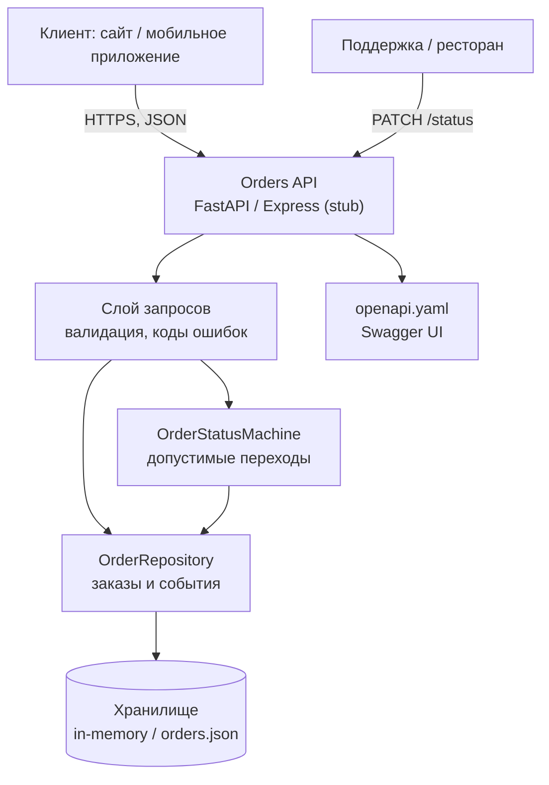
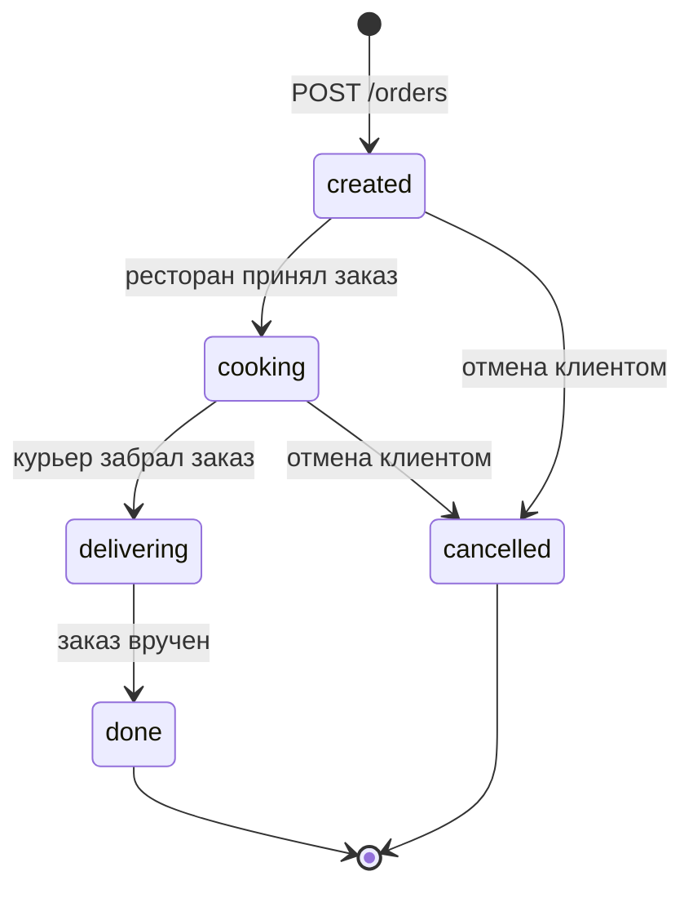

# Техническая документация «FoodTrack»

Документ описывает учебный сервис отслеживания заказов доставки еды: границы системы, архитектуру, структуру репозитория, запуск, конечный автомат статусов и договорённости API. Контракт API — [`openapi.yaml`](../openapi.yaml).

## 1. Назначение и границы

Сервис хранит заказы и журнал изменения их статусов, отдаёт клиенту карточку заказа и историю, принимает команды смены статуса и отмены. Работа учебная: реальной интеграции с кухней, курьерами и платёжным шлюзом нет, вместо неё — mock-сервер по спецификации.

В зону ответственности входят:

- создание заказа и расчёт суммы по позициям меню;
- хранение текущего статуса и полной истории переходов;
- проверка допустимости перехода и отмены;
- фильтрация и пагинация списка заказов.

Вне зоны ответственности: аутентификация клиента (в учебной версии не реализуется), оплата, карты и GPS-трекинг курьера, уведомления по SMS.

## 2. Архитектура

Система разделена на три уровня: клиент, API и хранилище. Отдельный модуль правил статусов изолирует конечный автомат от HTTP-слоя, поэтому правила можно тестировать без сервера.



Компоненты:

| Компонент | Ответственность |
|-----------|-----------------|
| `Orders API` | HTTP-маршруты из `openapi.yaml`, сериализация JSON, коды ответов |
| `Слой запросов` | Проверка тела и параметров, единый формат ошибки, `Idempotency-Key` |
| `OrderStatusMachine` | Таблица переходов, запрет отмены после передачи курьеру |
| `OrderRepository` | Чтение/запись заказа, добавление `StatusEvent`, выборка с фильтром и пагинацией |
| `Хранилище` | В учебной версии — память процесса или JSON-файл; в продуктивной — PostgreSQL |

Ключевое решение: статус меняется только через `PATCH /orders/{orderId}/status` или `POST /orders/{orderId}/cancel`. Прямая запись поля `status` в хранилище запрещена — иначе история и текущее состояние разойдутся.

## 3. Структура репозитория

```text
lab8/
├── README.md       # постановка задачи, обзор, навигация
├── user.md         # руководство клиента
├── tech.md         # этот документ
└── openapi.yaml    # контракт API: 5 путей, 6 операций, 11 схем
```

Каталогов `src/` или `api/` в сдаче нет: реализация заменена спецификацией и mock-сервером, как допускает постановка. При появлении кода предлагается раскладка `src/api` (маршруты), `src/domain` (машина статусов), `src/storage` (репозиторий).

## 4. Запуск и просмотр спецификации

Требуется Python 3.10+ (для статического сервера и проверки YAML) и Node.js 18+ — только если нужен mock-сервер.

```bash
# из корня lab8
python -m http.server 8000
# сама спека: http://localhost:8000/openapi.yaml
```

Чтобы отрисовать её в Swagger UI, откройте <https://editor.swagger.io> и импортируйте `openapi.yaml` (File → Import File) или укажите URL локального сервера (File → Import URL).

Проверка синтаксиса и структуры:

```bash
python -c "import yaml; yaml.safe_load(open('openapi.yaml', encoding='utf-8'))"
npx @redocly/cli lint openapi.yaml
```

Mock-сервер с ответами из `examples` (удобно для демонстрации):

```bash
npx @stoplight/prism-cli mock openapi.yaml --port 8080
curl http://localhost:8080/api/v1/orders/1042
```

Спецификация — статический файл; для просмотра достаточно Swagger Editor или любого YAML-редактора. Mock-сервер выше поднимает её как работающий контракт.

## 5. Конечный автомат статусов

Статусы: `created`, `cooking`, `delivering`, `done`, `cancelled`. Первые четыре образуют основной путь, `cancelled` — боковая ветка.



Допустимые переходы (всё, чего нет в таблице, — `409 INVALID_STATUS_TRANSITION`):

| Из \ В | `created` | `cooking` | `delivering` | `done` | `cancelled` |
|--------|-----------|-----------|--------------|--------|-------------|
| `created` | — | ✅ | ❌ | ❌ | ✅ |
| `cooking` | ❌ | — | ✅ | ❌ | ✅ |
| `delivering` | ❌ | ❌ | — | ✅ | ❌ |
| `done` | ❌ | ❌ | ❌ | — | ❌ |
| `cancelled` | ❌ | ❌ | ❌ | ❌ | — |

Правила:

- переход только «вперёд» по основному пути, на один шаг; перескок `created → delivering` запрещён;
- `done` и `cancelled` — терминальные, из них переходов нет;
- отмена разрешена только из `created` и `cooking`; попытка отменить `delivering` даёт `409 CANCEL_NOT_ALLOWED`;
- повторная установка текущего статуса (`delivering → delivering`) считается идемпотентной и возвращает `200` без добавления события;
- каждый успешный переход добавляет запись `StatusEvent` с автором: `customer`, `restaurant`, `courier` или `system`.

## 6. Модель данных

| Сущность | Ключ | Основные поля |
|----------|------|---------------|
| `Order` | `orderId` (int64) | `status`, `customer`, `deliveryAddress`, `items[]`, `totalPrice`, `courier`, `createdAt`, `updatedAt`, `estimatedDeliveryAt` |
| `OrderItem` | `itemId` | `dishId`, `name`, `quantity`, `unitPrice`, `totalPrice` |
| `StatusEvent` | `eventId` | `status`, `changedAt`, `changedBy`, `comment` |
| `Courier` | — | `name`, `phone` |

Суммы — целые числа в рублях (`totalPrice` = сумма `quantity × unitPrice` по всем позициям). Валюта одна — RUB; отдельного поля валюты нет, чтобы не усложнять учебный контракт. `courier` отсутствует (`null`), пока заказ не передан в доставку.

## 7. Формат даты и времени

- Все даты — строки **ISO 8601 / RFC 3339 в UTC**: `2026-11-25T12:24:10Z`.
- Смещения вида `+07:00` в API не используются; хранение и передача — только UTC.
- Клиент переводит время в часовой пояс пользователя сам; в интерфейсе показывается местное время.
- Точность — до секунды, миллисекунды не передаются.
- `estimatedDeliveryAt` — расчётное время вручения, может уточняться при переходе в `delivering`; `updatedAt` меняется при каждом переходе.

## 8. Переменные окружения

| Переменная | По умолчанию | Назначение |
|------------|--------------|------------|
| `PORT` | `8080` | Порт HTTP-сервера |
| `BASE_PATH` | `/api/v1` | Префикс всех маршрутов (совпадает с `servers` в спеке) |
| `ORDERS_STORE` | `memory` | Тип хранилища: `memory` или `file` |
| `ORDERS_FILE` | `./data/orders.json` | Путь к файлу при `ORDERS_STORE=file` |
| `DEFAULT_PAGE_LIMIT` | `20` | Размер страницы по умолчанию для `GET /orders` |
| `MAX_PAGE_LIMIT` | `100` | Максимально допустимый `limit` |
| `IDEMPOTENCY_TTL_HOURS` | `24` | Срок хранения ключей идемпотентности |
| `CORS_ORIGIN` | `http://localhost:8000` | Источник, которому разрешены запросы из Swagger UI |
| `LOG_LEVEL` | `info` | Уровень логирования (`debug`, `info`, `warn`, `error`) |

Секретов в учебной версии нет; при подключении платёжного шлюза ключи передаются только через переменные окружения и не попадают в репозиторий.

## 9. Договорённости по ошибкам

Все ошибки возвращаются в едином формате `Error`:

```json
{
  "code": "INVALID_STATUS_TRANSITION",
  "message": "Нельзя перевести заказ из delivering в created",
  "details": { "orderId": 1042, "from": "delivering", "to": "created" }
}
```

| HTTP | Когда возникает | Примеры `code` |
|------|-----------------|----------------|
| `400` | Некорректный запрос: битый JSON, неизвестный статус в фильтре, `limit` > 100 или отрицательный `offset` | `BAD_REQUEST` |
| `404` | Заказ с указанным `orderId` не существует | `ORDER_NOT_FOUND` |
| `409` | Конфликт с текущим состоянием: недопустимый переход, отмена после передачи курьеру | `INVALID_STATUS_TRANSITION`, `CANCEL_NOT_ALLOWED` |
| `422` | Семантически неверные данные: пустой список блюд, количество ≤ 0, пустой адрес | `VALIDATION_FAILED` |

Различие `400` и `422`: `400` — запрос нельзя разобрать или параметр вне допустимого диапазона; `422` — запрос разобран, но нарушает бизнес-правила. Тексты `message` — на русском, `code` — стабильный идентификатор для программной обработки.

## 10. Идемпотентность и пагинация

**Идемпотентность создания заказа.** `POST /orders` принимает необязательный заголовок `Idempotency-Key` (UUID). Сервер хранит ключ `IDEMPOTENCY_TTL_HOURS` (24 часа):

- повтор с тем же ключом и тем же телом возвращает `201` и **исходный** заказ, дубликат не создаётся, в ответе выставляется `Idempotency-Replayed: true`;
- повтор с тем же ключом и другим телом отклоняется с `400 BAD_REQUEST` — ключ нельзя переиспользовать для другого заказа;
- без заголовка каждое обращение создаёт новый заказ.

Смена статуса идемпотентна по смыслу: повтор текущего статуса возвращает `200` без нового события, поэтому клиент может безопасно повторять запрос при таймауте.

**Пагинация.** `GET /orders` использует `limit` (по умолчанию 20, максимум 100) и `offset` (≥ 0). Сортировка — по `createdAt` по убыванию, при равенстве — по `orderId` по убыванию. Ответ содержит `items` и блок `meta`:

```json
{ "items": [], "meta": { "total": 37, "limit": 20, "offset": 20 } }
```

`meta.total` — общее число заказов под фильтром, без учёта страницы. Следующая страница запрашивается с `offset = offset + limit`; если `offset ≥ total`, возвращается пустой `items` и `200`, а не `404`. Курсорная пагинация не используется: объём заказов одного клиента невелик, а `offset` проще для учебного контракта.
